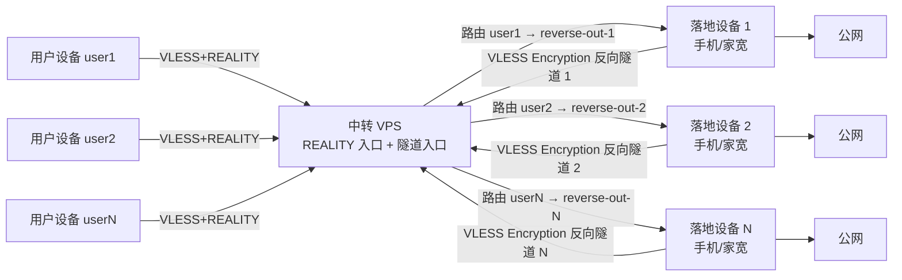

# Xray VLESS 反向代理（多用户一对一落地）部署脚本

一个面向**中转 VPS** 的交互式部署脚本：多台落地设备（手机/家宽）主动回连 VPS 建立专属反向隧道，外部用户接入后，其**全部流量**由对应的落地设备出口，一一对应、无需分流。

支持 **Alpine Linux（OpenRC）**、**Debian**、**Ubuntu（systemd）**，单个脚本自动识别初始化系统，只依赖系统自带工具，无需额外安装 bash。

- 用户 `user1` 接入 VPS → 流量经隧道 1 → 落地设备 1 出口
- 用户 `user2` 接入 VPS → 流量经隧道 2 → 落地设备 2 出口
- 依此类推，每个用户对应一台专属落地设备

> 配置字段仅使用 Xray-core 官方全量文档（[llms-full.txt](https://xtls.github.io/llms-full.txt)）确认过的字段；安装、客户端导入、分享链接等非配置内容均以官方安装脚本、官方分享链接标准提案和相关客户端项目为准。

## 架构与原理



原理（依据官方文档 [VLESS 反向代理示例](https://xtls.github.io/document/level-2/vless_reverse.html)）：

1. 每台落地设备在 Xray 客户端中配置一个带 `reverse` 的 VLESS 出站，主动连接 VPS 的隧道入口并保持在线，形成一条反向隧道；
2. 服务端为每个隧道客户端声明独立的 `reverse.tag`（`reverse-out-N`），该 tag 表现为一个可路由的出站；
3. VPS 的路由规则按 `user`（email）把用户流量**全量**送到对应的 `reverse-out-N`，不附加任何域名/IP 条件；
4. 落地设备收到经反向隧道转发来的流量后，交给 `home-direct`（freedom）从本地出口访问公网。

## 特性

- 单个 POSIX `sh` 脚本，Alpine / Debian / Ubuntu 通用，自动识别 systemd 与 OpenRC
- 只依赖系统自带工具（wget 或 curl、sed、awk、tr、cut 等），不额外安装 bash
- 小内存友好：安装、校验、生成配置均为轻量操作，常驻仅 Xray 单进程
- 交互式一键部署，所有凭证自动生成：UUID、REALITY X25519 密钥对、VLESS Encryption 对、shortId
- 支持 N 个用户，第 N 个用户自动对应第 N 台落地设备（隧道 tag、UUID、配置文件一一对应）
- 可选：额外添加一个出口为中转 VPS 直连的 VLESS Reality 节点（SNI 与主入口一致，默认 itunes.apple.com）
- target 为 CDN 域名时询问是否启用回落限速（`limitFallbackUpload` / `limitFallbackDownload`），防止未授权流量被偷跑
- 自动安装 Xray：systemd 系统用官方脚本 [XTLS/Xray-install](https://github.com/XTLS/Xray-install)，Alpine 用其官方 OpenRC 专属安装脚本，也可手动下载
- 写入配置前自动备份；写入后执行 `xray run -test` 校验，失败自动还原旧配置
- 自动创建 systemd 或 OpenRC 服务并放行 ufw 端口（Debian/Ubuntu 且 ufw 启用时）
- 为每台落地设备单独生成一份客户端配置 `/root/xray-bridge-<email>.jsonc`
- 末尾打印每个用户的 VLESS 分享链接与 UUID 对应关系表

## 目录结构

```text
xray-reverse-setup.sh   部署脚本（在 VPS 上执行）
README.md               本文档
```

## 快速开始（中转 VPS）

### 前置条件

- 一台有公网 IP 的 Linux VPS：Debian / Ubuntu（systemd）或 Alpine Linux（OpenRC），能以 root 执行
- 云厂商安全组 / 防火墙放行两个 TCP 端口（默认 `443`、`8443`，可在脚本中修改）
- 落地设备：安装 v2rayNG（Android）或 v2rayN（Windows）等支持自定义配置的客户端

### 运行

```bash
wget -O xray-reverse-setup.sh https://raw.githubusercontent.com/loser641/xray-reverse-setup/main/xray-reverse-setup.sh
chmod +x xray-reverse-setup.sh
./xray-reverse-setup.sh
```

需要 root（`su -` 或 `sudo` 均可）。没有 wget 时可用 curl：

```bash
curl -fsSL -o xray-reverse-setup.sh https://raw.githubusercontent.com/loser641/xray-reverse-setup/main/xray-reverse-setup.sh
chmod +x xray-reverse-setup.sh
./xray-reverse-setup.sh
```

> 脚本为 `#!/bin/sh`，Alpine 上由自带的 busybox ash 直接执行，无需安装 bash。

### 交互参数

| 提示项 | 默认值 | 说明 |
| --- | --- | --- |
| VPS 公网 IP 或域名 | 自动探测 | 写入落地设备配置与分享链接 |
| 用户接入端口 | `443` | VLESS + REALITY 入口 |
| 反向隧道端口 | `8443` | 落地设备回连入口 |
| REALITY 伪装目标 target | `itunes.apple.com:443` | 格式 `域名:端口`，文档确认 `target` 与旧名 `dest` 互为别名 |
| SNI 列表 | target 的主机名 | 逗号分隔 |
| shortId | 随机生成 | 16 位以内十六进制，位数必须为偶数（文档限制） |
| 用户 email 列表 | `user1,user2` | 第 N 个用户对应第 N 台落地设备 |
| 是否添加 VPS 直连节点 | `Y` | 额外生成一个出口为中转 VPS 的 VLESS Reality 用户（SNI 与主入口一致） |
| 是否启用 CDN 回落限速 | `Y` | target 为 CDN 域名时，防止未授权流量被偷跑（文档字段 `limitFallbackUpload`/`limitFallbackDownload`） |
| VLESS Encryption 认证 | X25519 | 可选 ML-KEM-768（后量子，更长），服务端与客户端必须一致 |

### 脚本完成后的产物

| 产物 | 位置 | 说明 |
| --- | --- | --- |
| 服务端配置 | `/usr/local/etc/xray/config.json` | JSONC，含中文注释 |
| 旧配置备份 | `/usr/local/etc/xray/config.json.bak.<时间戳>` | 覆盖前自动生成 |
| systemd / OpenRC 服务 | `/etc/systemd/system/xray.service` 或 `/etc/init.d/xray` | 已启用并启动 |
| 落地设备配置 | `/root/xray-bridge-<email>.jsonc` | 每个用户一份，拷贝到对应设备导入 |
| 分享链接 | 脚本末尾打印 | 每个用户一条 |

## 安装 Xray 的方式（脚本内部）

### 方式一：官方安装脚本（推荐）

**Debian / Ubuntu（systemd）**：

```bash
bash -c "$(curl -L https://github.com/XTLS/Xray-install/raw/main/install-release.sh)" @ install
```

**Alpine Linux（OpenRC）**：官方主安装脚本仅支持 systemd，因此使用 XTLS/Xray-install 仓库中独立的 Alpine 安装脚本（脚本内部自动处理）：

```sh
apk add curl
curl -O -L https://github.com/XTLS/Xray-install/raw/main/alpinelinux/install-release.sh
ash install-release.sh
```

官方安装脚本（[XTLS/Xray-install](https://github.com/XTLS/Xray-install)，含 [Alpine/OpenRC 专属说明](https://github.com/XTLS/Xray-install/tree/main/alpinelinux)）的约定：

- 二进制：`/usr/local/bin/xray`
- 配置目录：`/usr/local/etc/xray/`（主配置 `config.json`）
- 地理数据：`/usr/local/share/xray/geoip.dat`、`geosite.dat`
- systemd 服务：`/etc/systemd/system/xray.service`
- 新安装默认以 `User=nobody` 运行；`-u root` 可指定 root
- 默认**不**写 `/var/log/xray/*.log`，日志由配置中的 `log` 项决定

常用命令：

```bash
# 仅更新地理数据（systemd 系统）
bash -c "$(curl -L https://github.com/XTLS/Xray-install/raw/main/install-release.sh)" @ install-geodata

# 卸载（保留配置与日志）
bash -c "$(curl -L https://github.com/XTLS/Xray-install/raw/main/install-release.sh)" @ remove
```

### 方式二：手动下载 GitHub Release

脚本按 `uname -m` 自动选择 `Xray-linux-64.zip` 或 `Xray-linux-arm64-v8a.zip`，解压后安装到 `/usr/local/bin/xray`，地理数据放入 `/usr/local/share/xray/`。

## 生成的服务端配置说明

生成的配置包含两个入站：

### 1. 用户接入入口（`user-in`）：VLESS + REALITY

```jsonc
{
  "tag": "user-in",
  "port": 443,
  "protocol": "vless",
  "settings": {
    "decryption": "none",   // VLESS 未启用 Encryption 时固定为 none（文档：不能留空）
    "users": [              // 每个外部用户一项
      { "id": "...", "email": "user1", "flow": "xtls-rprx-vision" }
    ]
  },
  "streamSettings": {
    "method": "raw",        // 文档正式字段，默认即 raw（TCP）
    "security": "reality",
    "realitySettings": {
      "target": "itunes.apple.com:443",   // 旧名 dest，互为别名
      "serverNames": ["itunes.apple.com"],// 必填，不支持 * 通配符
      "privateKey": "...",                // xray x25519 生成
      "shortIds": ["a1"]                  // 必填，偶数位十六进制
    }
  }
}
```

### 2. 隧道入口（`bridge-in`）：VLESS + VLESS Encryption

```jsonc
{
  "tag": "bridge-in",
  "port": 8443,
  "protocol": "vless",
  "settings": {
    "decryption": "mlkem768x25519plus...", // xray vlessenc 生成
    "users": [
      {
        "id": "...",                        // 第 N 台落地设备的回连 UUID
        "flow": "xtls-rprx-vision",
        "reverse": { "tag": "reverse-out-1" } // 每个设备独立的 tag
      }
    ]
  },
  "streamSettings": { "method": "raw", "security": "none" }
}
```

> 文档确认：VLESS 默认必须配合传输安全层；**只有启用 VLESS Encryption 后**，`streamSettings.security` 才允许为 `none`。隧道入口正是利用这一条，用 Encryption 保护载荷、以明文 TCP 外观回连，适合不暴露公网入口的落地设备。

### 可选：VPS 直连节点

若在交互中确认添加，REALITY 入站的 `users` 数组会额外多出一个用户（默认 email `direct`），路由规则为 `user: ["direct"] → direct`，其流量直接由中转 VPS 出口，不进入任何反向隧道，分享链接在脚本末尾与落地用户一并打印。

### 可选：CDN 回落限速

REALITY 伪装目标默认是 `itunes.apple.com` 这类 CDN 域名。官方文档警告：当 target 为 CDN 时，未通过 REALITY 鉴权的连接会被直接转发到 target，相当于把 VPS 变成 CDN 的端口转发器，可能被扫描后偷跑流量。脚本在确认添加直连节点后询问是否启用回落限速，启用时会在 `realitySettings` 中生成（数值采用文档示例）：

```jsonc
"limitFallbackUpload":   { "afterBytes": 10485760, "bytesPerSec": 1048576, "burstBytesPerSec": 5242880 },
"limitFallbackDownload": { "afterBytes": 10485760, "bytesPerSec": 1048576, "burstBytesPerSec": 5242880 }
```

文档同时提到前置 Nginx 过滤 SNI 等替代方案，脚本未实现。

### 3. 路由：全量一一对应

```jsonc
{
  "domainStrategy": "AsIs",
  "rules": [
    { "user": ["user1"], "outboundTag": "reverse-out-1" },
    { "user": ["user2"], "outboundTag": "reverse-out-2" }
  ]
}
```

文档强调：公网服务器必须保留明确的默认出站（脚本保留 `freedom`，tag 为 `direct`），否则未命中规则的流量可能误入反向隧道。

## 用户侧接入

### 分享链接格式

脚本打印的链接格式：

```text
vless://<UUID>@<VPS_IP>:443?security=reality&flow=xtls-rprx-vision&type=tcp&sni=<目标主机名>&pbk=<PublicKey>&sid=<shortId>&fp=chrome#<email>
```

参数依据官方文档引用的 [VMessAEAD / VLESS 分享链接标准提案](https://github.com/XTLS/Xray-core/discussions/716)：

| 参数 | 对应配置字段 | 说明 |
| --- | --- | --- |
| `type=tcp` | 传输方式 | RAW/TCP；可选 tcp/kcp/ws/http/grpc/httpupgrade/xhttp |
| `security=reality` | `security` | 可选 none/tls/reality，默认 none |
| `flow=xtls-rprx-vision` | `flow` | VLESS 流量整形 |
| `sni=` | `serverName` | 省略时复用 remote-host，不可为空 |
| `pbk=` | `password`（REALITY） | REALITY 场景**不可省略** |
| `sid=` | `shortId`（REALITY） | 可省略或为空 |
| `fp=chrome` | `fingerprint` | REALITY 场景**不可省略**，默认 chrome |

> 描述文本（`#` 后的部分）按提案要求应做 URL 转义；脚本默认使用 ASCII 的 email 作为描述，通常无需额外处理。

### 导入方式

**v2rayNG（Android）**：复制分享链接 → 右上角 `+` → 从剪贴板导入。

**v2rayN（Windows）**：服务器 → 添加 [VLESS] 服务器（或从剪贴板导入链接）。

若添加了 VPS 直连节点，脚本末尾会额外打印一条标注“（VPS 直连）”的分享链接，该节点与落地用户共用同一个 REALITY 入口（同一 SNI、shortId、密钥），只是出口为中转 VPS 本身。

## 落地设备部署（手机/家宽）

每台落地设备使用脚本生成的独立配置文件，例如 `/root/xray-bridge-user2.jsonc`。该配置包含：

- 一个带 `reverse: { "tag": "reverse-in-N" }` 的 VLESS 出站，主动连接 VPS 隧道入口；
- 一个 `home-direct`（freedom）出站，`finalRules` 仅放行公网目标（`!geoip:private`），与官方示例一致；
- 一条路由：从 `reverse-in-N` 进入的流量 → `home-direct`。

### v2rayNG（Android 手机）

1. 把对应的 `xray-bridge-<email>.jsonc` 内容复制到剪贴板；
2. 右上角 `+` → 从剪贴板导入（v2rayNG 可自动识别 JSON 自定义配置）；
3. 选中该配置并连接；
4. 系统弹出 VPN 请求时选择**取消**（仅代理模式，不走全局 VPN）；
5. 保持应用在线（建议加入电池优化白名单/允许后台运行），反向隧道建立后 VPS 端的用户流量即可经此出口。

### v2rayN（Windows）

1. 保存为 `bridge.json`；
2. 服务器 → 添加[自定义配置]服务器 → 导入配置文件 → 选择该文件 → 保存；
3. 设为活动服务器，**不要**开启“自动配置系统代理”（落地端不需要代理本地流量）。

## 维护与故障排查

```bash
systemctl status xray          # 查看服务状态
systemctl restart xray         # 重启
journalctl -u xray -n 50       # 查看最近日志
xray run -test -c /usr/local/etc/xray/config.json   # 仅校验配置
```

Alpine（OpenRC）：

```sh
rc-service xray status         # 查看服务状态
rc-service xray restart        # 重启
rc-update add xray             # 设置开机自启
rc-service xray checkconfig    # 校验配置
```

常见问题：

| 现象 | 排查方向 |
| --- | --- |
| 用户连不上 VPS | 云厂商安全组/防火墙是否放行接入端口（Alpine 默认无防火墙，多为云安全组）；REALITY target 是否可达；SNI/shortId 与分享链接是否一致 |
| 连上但无法上网 | 对应落地设备是否在线（隧道未建立）；落地端是否取消 VPN 弹窗（代理模式）；落地端 `home-direct` 是否放行公网 |
| 只有部分用户能用 | 检查路由规则与 tunnel 编号是否一一对应；用户 email 是否与分享链接的 UUID 对应 |
| 配置报错 | `xray run -test` 查看具体错误；脚本失败时会自动还原备份配置 |
| 隧道掉线 | 手机后台被杀；给 v2rayNG 加电池白名单/允许自启动，或使用保活方案 |

小内存 VPS 提示：Xray 单进程常驻内存约几十 MB；脚本本身不额外占用常驻资源，安装完成后会自动清理下载的临时文件。

## 安全建议

- REALITY 伪装目标建议选择**与 VPS 同 ASN** 的站点（官方文档建议），降低被识别风险；如使用 CDN 站点，注意文档关于回落流量被偷跑的警告
- `privateKey`、`decryption` 等私密字段不要泄露；分享链接中的 `pbk` 是公钥，可以公开
- 只开放必要的端口（默认 443、8443），落地端端口可改非默认值降低扫描面
- 落地设备是整条链路的关键，建议交给可信设备并保持在线

## 参考链接

- Xray-core 官方全量文档：<https://xtls.github.io/llms-full.txt>
- 官方 VLESS 反向代理示例：<https://xtls.github.io/document/level-2/vless_reverse.html>
- 官方安装脚本：<https://github.com/XTLS/Xray-install>
- Alpine/OpenRC 专属安装说明：<https://github.com/XTLS/Xray-install/tree/main/alpinelinux>
- VLESS 分享链接标准提案：<https://github.com/XTLS/Xray-core/discussions/716>
- v2rayNG：<https://github.com/2dust/v2rayNG>
- v2rayN：<https://github.com/2dust/v2rayN>

## 说明与未确认内容

- **一对一专属隧道**：官方文档详细示例了多条回连共用同一 `reverse.tag` 形成可用池（N 对 N），未直接给出“每个用户一条专属隧道”的多用户示例；本脚本基于文档确认的字段组合实现（每个客户端独立 `reverse.tag` + 按 `user` 路由到指定 `outboundTag`）。
- **分享链接**：格式遵循官方文档引用的分享链接标准提案；不同客户端的导入行为以其各自文档为准。
- **systemd/OpenRC 服务单元与 ufw**：属于系统部署层面，官方 Xray 文档未规定具体写法；脚本参照官方 XTLS/Xray-install 提供的模板实现。
- **Alpine 手动安装路径**：若官方 Alpine 安装脚本不可用，脚本会回退到手动下载；Alpine 上解压依赖 `unzip`（busybox 自带或 `apk add unzip`），这属于系统工具而非脚本功能。
- **回落限速数值**：`limitFallbackUpload`/`limitFallbackDownload` 为官方文档确认字段，脚本默认采用文档示例中的数值（约 10 MB 后限速 1 MB/s、突发 5 MB/s），可按需在生成的配置中调整；文档还提到前置 Nginx 过滤 SNI 等防偷跑替代方案。
