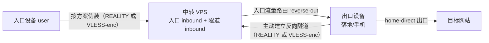

# Xray VLESS 反向代理（多场景一对一落地）部署 / 管理脚本

面向**中转 VPS（通常在境外）**的部署 / 管理脚本：出入口设备各在一端，通过 VLESS 反向隧道实现“用户 A 的流量经其专属落地设备出口”，并按设备所在位置自动选择合适伪装，避免不必要的特征暴露。部署后输入 `lray` 打开管理面板，可随时改 SNI、端口、UUID、密钥。

支持 **Alpine Linux（OpenRC）**、**Debian**、**Ubuntu（systemd）**，单个 POSIX `sh` 脚本自动识别初始化系统，只依赖系统自带工具，无需安装 bash。

> 配置字段仅使用 Xray-core 官方全量文档（[llms-full.txt](https://xtls.github.io/llms-full.txt)）确认过的字段；安装、客户端导入、分享链接等非配置内容以官方安装脚本、官方分享链接标准提案和相关客户端项目为准。

## 四种方案（VPS 在境外）

| 方案 | 入口设备位置 | 出口设备位置 | 入口 → VPS | 出口设备 → VPS（隧道） |
| --- | --- | --- | --- | --- |
| 1 | 国内 | 国外 | VLESS+REALITY | VLESS Encryption |
| 2 | 国外 | 国内 | VLESS Encryption | VLESS+REALITY |
| 3 | 国外 | 国外 | VLESS Encryption | VLESS Encryption |
| 4 | 国内 | 国内 | VLESS+REALITY | VLESS+REALITY |

原则：**哪一端设备在国内，那一端就用 VLESS+REALITY 伪装成 HTTPS；国外端直接用简单的 VLESS Encryption**。

脚本部署时可一次选择多个方案（如 `1`、`4`、`1,4`、`1234`）。**同一协议的方案共用一个入站和端口**，每个方案只是其中不同的用户（UUID + email）：

| 入站 | 默认端口 | 承载 |
| --- | --- | --- |
| `in-reality`（VLESS+REALITY） | 40443 | 方案 1/4 入口、方案 2/4 隧道、直连节点 |
| `in-enc`（VLESS Encryption） | 50443 | 方案 2/3 入口、方案 1/3 隧道 |

可另外选择是否添加一个**出口为中转 VPS 的 VLESS+REALITY 直连节点**（占用 REALITY 端口，独立 UUID）。

## 架构与原理



原理（依据官方文档 [VLESS 反向代理示例](https://xtls.github.io/document/level-2/vless_reverse.html)）：

1. 出口设备在 Xray 客户端中配置带 `reverse` 的 VLESS 出站，主动回连 VPS 隧道入口并保持在线；
2. 服务端为每个隧道客户端声明独立 `reverse.tag`，表现为可路由出站；
3. VPS 按入口用户的 email 把流量送到对应 `reverse-out-N`（同一端口可以同时服务多个方案）；
4. 出口设备把流量交给 `home-direct`（freedom）从本地网络出口。

## 特性

- 四种方案可多选；同协议方案共用入站/端口，最多只占 2 个端口（+0）
- 每个方案独立入口/隧道 UUID，通过 email + `user` 路由精确对应
- VLESS 入站统一使用 `clients`（实测 Xray 26.x 运行时只注册 `clients` 中的用户）
- 所有凭证随机生成：UUID、REALITY 私钥/公钥、VLESS Encryption 对、shortId，不内置默认值
- 可选“出口为中转 VPS 的 VLESS+REALITY 直连节点”（复用 REALITY 端口）
- 写入配置前自动备份，写入后 `xray run -test` 校验，失败不落地
- 自动创建 systemd/OpenRC 服务（受限容器自动回退 `local.d + nohup`）并放行 ufw/firewalld 端口
- 管理面板：改 SNI/target、端口、UUID、shortId、REALITY 密钥、Encryption 密钥、方案组合、直连开关
- 安装 `lray` 快捷命令，随时打开面板（自动取最新脚本，离线回退本地缓存）

## 快速开始

root 下一条命令即可（脚本直接从终端读取交互输入，不需要先落盘）：

```bash
sh -c "$(wget -qO- https://github.com/loser641/xray-reverse-setup/raw/main/xray-reverse-setup.sh)"
```

没有 wget 时用 curl：

```bash
sh -c "$(curl -fsSL https://github.com/loser641/xray-reverse-setup/raw/main/xray-reverse-setup.sh)"
```

`sh -c` 的第一个参数是脚本的 `$0`，后面的参数会传给脚本：

```bash
# 先看用法，不部署
sh -c "$(wget -qO- https://github.com/loser641/xray-reverse-setup/raw/main/xray-reverse-setup.sh)" xray-setup --help

# 无人值守：全部取默认值（会写配置并重启服务）
sh -c "$(wget -qO- https://github.com/loser641/xray-reverse-setup/raw/main/xray-reverse-setup.sh)" xray-setup --defaults
```

也可以先下载再执行：`wget -O xr.sh <脚本链接> && sh xr.sh`。

### 快捷命令 lray（管理面板）

每次运行本脚本时都会安装/更新 `/usr/local/bin/lray`。之后在 root shell 里直接输入：

```bash
lray              # 打开管理面板
lray --help       # 查看用法
lray --install    # 重新部署（会备份旧配置）
lray --defaults   # 重新部署时全部取默认值
```

面板里可以查看凭据、分享链接和客户端配置内容，并修改 SNI/target、端口、UUID、shortId、REALITY 密钥、VLESS Encryption 密钥、方案组合和直连开关；改完选“应用配置”才会写入、校验并重启。

`lray` 会先拉取仓库里的最新脚本并更新缓存（`/usr/local/share/xray-setup/`），网络失败时直接运行缓存；`LRAY_OFFLINE=1` 可强制离线。非 root 运行会提示 `sudo lray`。若还没有部署状态，`lray` 会提示进入安装流程。

### 交互要点

| 提示 | 默认 | 说明 |
| --- | --- | --- |
| 方案组合 | `4` | 如 `4`、`1,4`、`1234`；同协议方案共用一个入站 |
| 是否需要 VPS 直连节点 | `Y` | 复用 REALITY 端口，独立 UUID |
| REALITY target / SNI | `itunes.apple.com:443` | 伪装的真实站点，面板可改 |
| REALITY 端口 | `40443` | 方案 1/4 入口 + 方案 2/4 隧道 + 直连 |
| VLESS Encryption 端口 | `50443` | 方案 2/3 入口 + 方案 1/3 隧道 |
| VLESS Encryption 认证 | X25519 | 可改 ML-KEM-768，两端必须一致 |

uuid、REALITY 密钥对、Encryption 密钥、shortId 均在部署时随机生成，也可以在面板里重新生成。

### 生成产物

```text
/usr/local/etc/xray/config.json        服务端配置（自动备份旧配置）
/usr/local/etc/xray/xray-setup.state   部署状态（面板读取，600）
/usr/local/bin/lray                    管理面板快捷命令
/usr/local/share/xray-setup/           lray 的本地脚本缓存
/root/xray-bridge-caseN.jsonc          方案 N 出口设备（落地）配置
/root/xray-entry-caseN.jsonc           方案 N 入口为 VLESS-enc 时的境外端配置
/root/xray-deploy/credentials.txt      全部 UUID / 端口 / 协议汇总
```

入口为 REALITY（含直连节点）能直接导入，输出 `vless://` 分享链接；出口任何协议都要带 `reverse`，只能以文件导入；VLESS Encryption 无法用分享链接表达，面板和部署结束时会把整份配置（含起止标记）贴出来，直接复制保存即可。出口配置里带 `reverse`，必须原样存成 `xray-bridge-caseN.jsonc` 导入，分享链接表达不了反向隧道。取消掉的方案会自动删除对应的 `xray-bridge-caseN.jsonc` / `xray-entry-caseN.jsonc`。

## 服务端配置结构

服务端最多只有两个入站，按协议划分（用不到的协议不会生成）。两个入站都以 `"listen": "::"` 绑定，IPv4 / IPv6 双栈同时可用（Xray 26 即使写 `0.0.0.0` 也会归一到双栈，这里显式写死避免老版本差异）：

`in-reality`（默认 40443）的 `clients` 同时包含：

- 方案 1/4 的入口用户：`email = entry-caseN`，不带 `reverse`
- 方案 2/4 的隧道用户：`email = bridge-caseN`，带 `reverse: { "tag": "reverse-out-N" }`
- 直连节点用户：`email = direct`

`in-enc`（默认 50443）包含方案 2/3 的入口用户和方案 1/3 的隧道用户。

因为一个入站里有多个方案，路由按**用户邮箱**区分：

```jsonc
{ "inboundTag": ["in-reality"], "user": ["entry-case4"], "outboundTag": "reverse-out-4" }
{ "inboundTag": ["in-reality"], "user": ["direct"], "outboundTag": "direct" }
```

并保留默认 `freedom`（tag `direct`）出站。可用 `lray` 面板随时查看/修改这些参数。

## 客户端部署

> 客户端内核要求：Xray ≥ 25.9（v2rayNG 1.10+、v2rayN 7.x、mihomo 1.19+）。旧内核（1.8.x 等）连接 Xray 26 服务端会报 `REALITY: verification failed` 或 `REALITY: processed invalid connection`，也不认识 `"method": "raw"` 等新字段——先升级客户端再排查网络。

### 出口设备（落地）

把对应方案的 `xray-bridge-caseN.jsonc` 导入 v2rayNG（`+` → 从剪贴板导入；连接后 VPN 弹窗点取消，仅代理模式）或 v2rayN（添加自定义配置服务器），**保持在线**。

方案 2/4 的出口设备在境内，配置里隧道用 REALITY（伪装为 HTTPS）；方案 1/3 的出口设备在境外，配置里隧道为 VLESS Encryption。

### 入口设备

- 方案 1/4（境内）：直接导入分享链接（VLESS+REALITY）。
- 方案 2/3（境外）：脚本生成 `xray-entry-caseN.jsonc`（VLESS Encryption + 本地 SOCKS 1080），按客户端要求调整后导入。

## 维护与故障排查

```bash
# 管理面板（改配置、看凭据、查状态）
lray

# Debian/Ubuntu
systemctl status xray && journalctl -u xray -n 50
# Alpine
rc-service xray status
# 校验配置
xray run -test -c /usr/local/etc/xray/config.json
```

受限容器/最小化 Alpine 下脚本会自动使用 `local.d + nohup` 保持运行，日志在 `/var/log/xray/out.log`，手动管理用 `sh /etc/local.d/xray.start`。

常见问题：

| 现象 | 排查方向 |
| --- | --- |
| 入口能连但打不开网页 | 对应出口设备是否在线（隧道是否建立） |
| 隧道连不上 | 出口设备导入的是不是同一方案文件；境内出口用 REALITY、境外出口用 VLESS-enc 是否与 VPS 方案一致 |
| 只有部分用户能用 | 同一端口有多个用户：检查入口 UUID 是否属于该方案、对应出口设备是否在线 |
| 配置报错 | `xray run -test` 查看错误；脚本失败会自动还原备份 |

## 安全建议

- 境内设备连接的 VPS 入口统一用 REALITY 伪装（方案 1/4 入口、方案 2/4 隧道）；文档提示 VLESS Encryption 保护载荷但“不具备 HTTPS 外观，不适合直接用于过墙”，因此**境内端不要选 VLESS-enc**。
- REALITY 伪装目标建议与 VPS 同 ASN；使用 Apple/Cloudflare 类 CDN 域名或非 443 端口时核心会给出警告。
- `privateKey`、`decryption` 等私密字段不要泄露；分享链接中的 `pbk` 是公钥。
- UUID、REALITY 私钥/公钥、Encryption 密钥、shortId 全部随机生成；怀疑泄露时在 `lray` 面板里重新生成并应用，然后更新对应客户端。

## 参考链接

- Xray-core 官方全量文档：<https://xtls.github.io/llms-full.txt>
- VLESS 反向代理示例：<https://xtls.github.io/document/level-2/vless_reverse.html>
- 官方安装脚本：<https://github.com/XTLS/Xray-install>（[Alpine/OpenRC](https://github.com/XTLS/Xray-install/tree/main/alpinelinux)）
- VLESS 分享链接标准提案：<https://github.com/XTLS/Xray-core/discussions/716>
- v2rayNG / v2rayN：<https://github.com/2dust/v2rayNG> / <https://github.com/2dust/v2rayN>

## 说明与未确认内容

- VLESS 入站用户字段：官方参考文档写 `users`，实测运行时只注册 `clients`；脚本统一使用 `clients`。
- 多方案共用一个入站：官方路由文档支持按 `user`（即入站用户 email）匹配，脚本据此把同一端口上的不同 UUID 分流到各自的 `reverse-out-N`。
- “一对一专属隧道”：官方文档有共用 `reverse.tag` 的负载池示例，未直接给出逐用户专属隧道示例；脚本基于文档字段组合实现。
- VLESS Encryption 的客户端导入没有统一分享链接标准，方案 2/3 的境外入口和所有出口设备都以 JSON 配置形式提供；面板里会贴出整份内容。
- systemd/OpenRC 单元、ufw 属于系统部署层面，官方文档未规定写法，脚本参照官方安装脚本实现。
