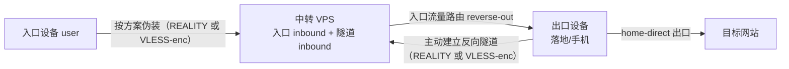

# Xray VLESS 反向代理（多场景一对一落地）部署脚本

面向**中转 VPS（通常在境外）**的交互式部署脚本：出入口设备各在一端，通过 VLESS 反向隧道实现“用户 A 的流量经其专属落地设备出口”，并按设备所在位置自动选择合适伪装，避免不必要的特征暴露。

支持 **Alpine Linux（OpenRC）**、**Debian**、**Ubuntu（systemd）**，单个 POSIX `sh` 脚本自动识别初始化系统，只依赖系统自带工具，无需安装 bash。

> 配置字段仅使用 Xray-core 官方全量文档（[llms-full.txt](https://xtls.github.io/llms-full.txt)）确认过的字段；安装、客户端导入、分享链接等非配置内容以官方安装脚本、官方分享链接标准提案和相关客户端项目为准。

## 四种方案（VPS 在境外）

| 方案 | 入口设备位置 | 出口设备位置 | 入口 → VPS | 出口设备 → VPS（隧道） |
| --- | --- | --- | --- | --- |
| 1 | 国内 | 国外 | VLESS+REALITY | VLESS Encryption |
| 2 | 国外 | 国内 | VLESS Encryption | VLESS+REALITY |
| 3 | 国外 | 国外 | VLESS Encryption | VLESS Encryption |
| 4 | 国内 | 国内 | VLESS+REALITY | VLESS+REALITY |

原则：**哪一端设备在国内，那一端就用 VLESS+REALITY 伪装成 HTTPS；国外端直接用简单的 VLESS Encryption**。

脚本部署时可一次选择多个方案（如 `1`、`4`、`12`、`1234`），每个方案会生成独立的一组“入口 + 隧道”，各配独立端口与 UUID；可另外选择是否添加一个**出口为中转 VPS 的 VLESS+REALITY 单节点**。

## 架构与原理



原理（依据官方文档 [VLESS 反向代理示例](https://xtls.github.io/document/level-2/vless_reverse.html)）：

1. 出口设备在 Xray 客户端中配置带 `reverse` 的 VLESS 出站，主动回连 VPS 隧道入口并保持在线；
2. 服务端为每个隧道客户端声明独立 `reverse.tag`，表现为可路由出站；
3. VPS 按入口 tag 把用户流量全量送到对应 `reverse-out-N`；
4. 出口设备把流量交给 `home-direct`（freedom）从本地网络出口。

## 特性

- 四种方案可多选，一次部署多组“入口 + 隧道”
- 每个方案独立端口、独立入口用户与出口设备 UUID，一一对应
- VLESS 入站统一使用 `clients`（实测 Xray 26.3.27 运行时只注册 `clients` 中的用户）
- 所有凭证自动生成：UUID、X25519 密钥对、VLESS Encryption 对、shortId
- 可选“出口为中转 VPS 的 VLESS+REALITY 单节点”
- 写入配置前自动备份，写入后 `xray run -test` 校验，失败自动还原
- 自动创建 systemd/OpenRC 服务（受限容器自动回退 `local.d + nohup`）并放行 ufw 端口

## 快速开始

root 下一条命令即可（脚本直接从终端读取交互输入，不需要先落盘）：

```bash
sh -c "$(wget -qO- https://github.com/loser641/xray-reverse-setup/raw/main/xray-reverse-setup.sh)"
```

没有 wget 时用 curl：

```bash
sh -c "$(curl -fsSL https://github.com/loser641/xray-reverse-setup/raw/main/xray-reverse-setup.sh)"
```

`sh -c` 的第一个参数是脚本的 `$0`，后面的参数会传给脚本：

```bash
# 先看用法，不部署
sh -c "$(wget -qO- https://github.com/loser641/xray-reverse-setup/raw/main/xray-reverse-setup.sh)" xray-setup --help

# 无人值守：全部取默认值（会写配置并重启服务）
sh -c "$(wget -qO- https://github.com/loser641/xray-reverse-setup/raw/main/xray-reverse-setup.sh)" xray-setup --defaults
```

也可以先下载再执行：`wget -O xr.sh <脚本链接> && sh xr.sh`。

### 交互要点

| 提示 | 默认 | 说明 |
| --- | --- | --- |
| 方案组合 | `4` | 如 `4`、`12`、`1234` |
| 各方案入口端口 | 4xxxx 表 | 方案1=40143、方案2=40243、方案3=40343、方案4=40443，可改 |
| 各方案隧道端口 | 5xxxx 表 | 方案1=50143、方案2=50243、方案3=50343、方案4=50443，可改 |
| 方案用户 email | `user-caseN` | 入口用户标识 |
| 是否需要 VPS 直连单节点 | `Y` | 出口为中转 VPS，VLESS+REALITY，端口默认 57717 |
| REALITY target / SNI | `itunes.apple.com:443` | 伪装的真实站点 |
| VLESS Encryption 认证 | X25519 | 可改 ML-KEM-768，两端必须一致 |

### 生成产物

```text
/usr/local/etc/xray/config.json        服务端配置（自动备份旧配置）
/root/xray-bridge-caseN.jsonc          方案 N 出口设备（落地）配置
/root/xray-entry-caseN.jsonc           方案 N 入口为 VLESS-enc 时的境外端配置
/root/xray-deploy/credentials.txt      全部 UUID / 端口 / 协议汇总
```

入口为 REALITY 的方案直接在脚本末尾打印分享链接。

## 服务端配置结构

每个被选中的方案 N 会生成两个入站：

- `user-case-N`：入口用户。方案 1/4 为 VLESS+REALITY（`security: "reality"`），方案 2/3 为 VLESS Encryption（`security: "none"` + `decryption`）。
- `bridge-case-N`：出口设备回连。方案 2/4 为 VLESS+REALITY，方案 1/3 为 VLESS Encryption；其客户端带 `reverse: { "tag": "reverse-out-N" }`。

路由按入口 tag 全量转发：

```jsonc
{ "inboundTag": ["user-case-4"], "outboundTag": "reverse-out-4" }
```

并保留默认 `freedom`（tag `direct`）出站。

## 客户端部署

### 出口设备（落地）

把对应方案的 `xray-bridge-caseN.jsonc` 导入 v2rayNG（`+` → 从剪贴板导入；连接后 VPN 弹窗点取消，仅代理模式）或 v2rayN（添加自定义配置服务器），**保持在线**。

方案 2/4 的出口设备在境内，配置里隧道用 REALITY（伪装为 HTTPS）；方案 1/3 的出口设备在境外，配置里隧道为 VLESS Encryption。

### 入口设备

- 方案 1/4（境内）：直接导入分享链接（VLESS+REALITY）。
- 方案 2/3（境外）：脚本生成 `xray-entry-caseN.jsonc`（VLESS Encryption + 本地 SOCKS 1080），按客户端要求调整后导入。

## 维护与故障排查

```bash
# Debian/Ubuntu
systemctl status xray && journalctl -u xray -n 50
# Alpine
rc-service xray status
# 校验配置
xray run -test -c /usr/local/etc/xray/config.json
```

受限容器/最小化 Alpine 下脚本会自动使用 `local.d + nohup` 保持运行，日志在 `/var/log/xray/out.log`，手动管理用 `sh /etc/local.d/xray.start`。

常见问题：

| 现象 | 排查方向 |
| --- | --- |
| 入口能连但打不开网页 | 对应出口设备是否在线（隧道是否建立） |
| 隧道连不上 | 出口设备导入的是不是同一方案文件；境内出口用 REALITY、境外出口用 VLESS-enc 是否与 VPS 方案一致 |
| 只有部分用户能用 | 端口/UUID/方案编号是否一一对应 |
| 配置报错 | `xray run -test` 查看错误；脚本失败会自动还原备份 |

## 安全建议

- 境内设备连接的 VPS 入口统一用 REALITY 伪装（方案 1/4 入口、方案 2/4 隧道）；文档提示 VLESS Encryption 保护载荷但“不具备 HTTPS 外观，不适合直接用于过墙”，因此**境内端不要选 VLESS-enc**。
- REALITY 伪装目标建议与 VPS 同 ASN；使用 Apple/Cloudflare 类 CDN 域名或非 443 端口时核心会给出警告。
- `privateKey`、`decryption` 等私密字段不要泄露；分享链接中的 `pbk` 是公钥。

## 参考链接

- Xray-core 官方全量文档：<https://xtls.github.io/llms-full.txt>
- VLESS 反向代理示例：<https://xtls.github.io/document/level-2/vless_reverse.html>
- 官方安装脚本：<https://github.com/XTLS/Xray-install>（[Alpine/OpenRC](https://github.com/XTLS/Xray-install/tree/main/alpinelinux)）
- VLESS 分享链接标准提案：<https://github.com/XTLS/Xray-core/discussions/716>
- v2rayNG / v2rayN：<https://github.com/2dust/v2rayNG> / <https://github.com/2dust/v2rayN>

## 说明与未确认内容

- VLESS 入站用户字段：官方参考文档写 `users`，实测运行时只注册 `clients`；脚本统一使用 `clients`。
- “一对一专属隧道”：官方文档有共用 `reverse.tag` 的负载池示例，未直接给出逐用户专属隧道示例；脚本基于文档字段组合实现。
- VLESS Encryption 的客户端导入没有统一分享链接标准，方案 2/3 的境外入口以 JSON 配置形式提供。
- systemd/OpenRC 单元、ufw 属于系统部署层面，官方文档未规定写法，脚本参照官方安装脚本实现。
